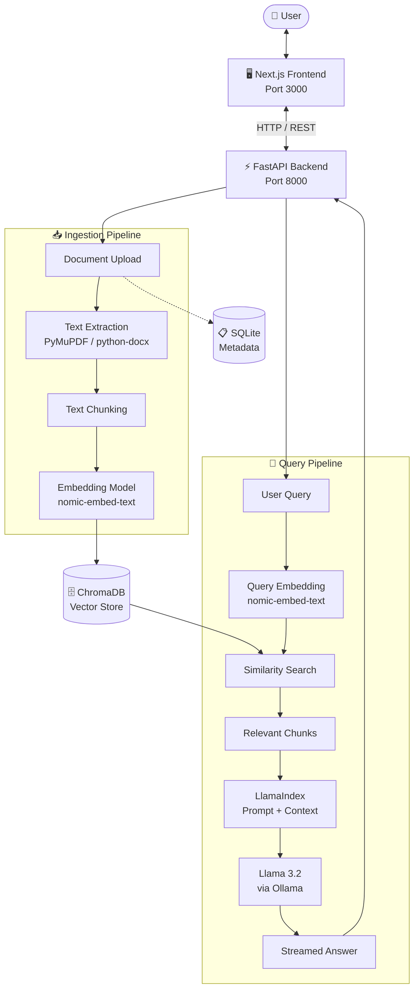

<div align="center">

# 🧠 Knowledge IQ

### Your Documents. Your Knowledge. Your AI Assistant.

A **local-first, AI-powered document intelligence platform** built on Retrieval-Augmented Generation (RAG).


[Features](#-key-features) • [Architecture](#-system-architecture) • [Tech Stack](#-technology-stack) • [Getting Started](#-getting-started) • [Privacy](#-data-storage-and-privacy) • [Roadmap](#-roadmap)

</div>

---

## 📖 Overview

Knowledge IQ lets you upload documents, retrieve relevant information through semantic search, and chat with your knowledge base using a **locally hosted Large Language Model (LLM)**.

Powered by **Ollama, ChromaDB, LlamaIndex, and FastAPI**, it turns static documents into an interactive knowledge assistant while giving you greater control over how your data is processed and stored.

---

## ✨ Key Features

| | Feature | Description |
|---|---|---|
| 📄 | **Multi-Format Support** | Upload PDF, DOCX, TXT, Markdown, CSV, JSON, and HTML files. |
| ⚙️ | **Intelligent Processing** | Extract and chunk document content for efficient retrieval. |
| 🔍 | **Semantic Search** | Find relevant passages using vector embeddings and similarity search. |
| 🤖 | **RAG Answers** | Generate context-aware answers grounded in retrieved content. |
| 🏠 | **Local LLM** | Run models locally through Ollama, with no hosted LLM API required. |
| 💾 | **Persistent Knowledge Base** | Store metadata and embeddings for repeated querying. |
| ⚡ | **Streaming Responses** | Receive answers incrementally as they are generated. |
| 🌍 | **Multilingual UI** | English, Spanish, French, German, Brazilian Portuguese, Japanese, Telugu, Hindi, and Tamil. |
| 🖥️ | **Interactive Dashboard** | Upload documents, manage your library, and chat with your assistant. |

---

## 🏗️ System Architecture

Knowledge IQ connects document ingestion, embedding generation, vector retrieval, and LLM-based response generation.



### Pipeline summary

| Stage | What happens |
|---|---|
| **1. Upload** | A document is uploaded from the dashboard to the FastAPI backend. |
| **2. Extract & Chunk** | Text is extracted (PyMuPDF, python-docx, etc.) and split into chunks. |
| **3. Embed & Store** | Chunks are embedded with `nomic-embed-text` and stored in ChromaDB; metadata goes to SQLite. |
| **4. Retrieve** | A user question is embedded and the most similar chunks are fetched from ChromaDB. |
| **5. Generate** | LlamaIndex builds a prompt from the question and retrieved context, and Llama 3.2 (via Ollama) produces the answer. |
| **6. Stream** | The answer is streamed back to the frontend. |

---

## 🛠️ Technology Stack

| Layer | Technologies |
|---|---|
| **Frontend** | Next.js, React, TypeScript |
| **Backend** | Python, FastAPI |
| **RAG Framework** | LlamaIndex |
| **LLM** | Llama 3.2 |
| **Embedding Model** | nomic-embed-text |
| **Vector Database** | ChromaDB |
| **Model Runtime** | Ollama |
| **Document Processing** | PyMuPDF, python-docx |
| **Metadata Storage** | SQLite |
| **API Communication** | HTTP / REST |

---

## ⚙️ Prerequisites

- Python 3.11 or later
- Node.js 20 or later and npm
- [Ollama](https://ollama.com)
- Git

---

## 🚀 Getting Started

### 1. Clone the repository

```bash
git clone <YOUR_GITHUB_REPOSITORY_URL>
cd knowledge-intelligence-dashboard
```

### 2. Download the AI models

```bash
ollama pull llama3.2
ollama pull nomic-embed-text
```

> Make sure Ollama is running before you start the application.

### 3. Set up the backend

```bash
python3 -m venv venv
```

Activate the virtual environment:

```bash
# macOS / Linux
source venv/bin/activate

# Windows
venv\Scripts\activate
```

Install dependencies:

```bash
python -m pip install fastapi uvicorn chromadb httpx python-multipart pymupdf python-docx \
  llama-index-core llama-index-llms-ollama llama-index-embeddings-ollama \
  llama-index-vector-stores-chroma llama-index-readers-file
```

### 4. Start the backend

From the directory containing `main.py`:

```bash
uvicorn main:app --reload --host 127.0.0.1 --port 8000
```

| Resource | URL |
|---|---|
| Backend | http://localhost:8000 |
| Health check | http://localhost:8000/health |
| Swagger UI (if enabled) | http://localhost:8000/docs |

### 5. Start the frontend

In a new terminal:

```bash
cd R
npm ci
npm run dev
```

Open **http://localhost:3000** in your browser.

### 6. Configure the app

Go to **Settings** in the application:

- Leave the **API URL** empty to explore **demo mode**.
- Set it to `http://localhost:8000` to connect to your local backend.

---

## 📂 Supported Document Formats

| Format | Extension | Status |
|---|---|---|
| PDF | `.pdf` | ✅ Supported |
| Word | `.docx` | ✅ Supported |
| Text | `.txt` | ✅ Supported |
| Markdown | `.md` | ✅ Supported |
| CSV | `.csv` | ✅ Supported |
| JSON | `.json` | ✅ Supported |
| HTML | `.html` | ✅ Supported |

> **Note:** Text-based PDFs are processed locally. Image-only or scanned PDFs require OCR, which is not included in this version.

---

## 🔌 API Overview

The FastAPI backend exposes endpoints for:

- Document upload and ingestion
- Document library management
- Semantic retrieval
- Context-aware question answering
- Streaming chat responses
- Backend health monitoring

Interactive documentation is available at `http://localhost:8000/docs` when Swagger UI is enabled. For exact endpoint paths and request formats, refer to the backend implementation.

---

## 🧪 Validation and Testing

**Backend tests**

```bash
./venv/bin/python -m unittest discover -s tests -v
```

**Frontend type check and production build**

```bash
cd R
npm run typecheck
npm run build
```

---

## 🔐 Data Storage and Privacy

Knowledge IQ stores data locally by default.

| Component | Default location |
|---|---|
| Vector database | `./chroma_db` |
| Uploaded documents | `./data/` |
| Document metadata | `./rag_metadata.sqlite3` |

**Good to know**

- Uploaded documents and their vector representations stay on your machine by default.
- Removing a document from the library deletes its vectors and metadata; the original file remains in `./data/` and can be re-indexed.
- Back up the vector database, uploaded documents, and metadata database together.
- The app does not currently provide authentication, tenant isolation, encryption-at-rest management, or a formal retention/deletion workflow.
- The frontend can be pointed at a non-local backend, so "local-first" does not guarantee that every deployment is fully local.

---

## ⚠️ Production Considerations

Before exposing Knowledge IQ publicly or deploying it for clients:

1. **Authentication & authorization:** add secure login and access controls.
2. **CORS:** set `ALLOWED_ORIGINS` to the exact frontend origins. CORS is not an authentication mechanism.
3. **Document security:** define storage, backup, retention, and deletion policies.
4. **OCR:** add support for scanned and image-based documents.
5. **RAG evaluation:** test retrieval relevance, answer accuracy, and citation correctness.
6. **Background jobs:** use durable workers for long-running indexing.
7. **Monitoring:** track availability, indexing failures, retrieval latency, and model performance.
8. **Scalability:** assess hardware needs, document size limits, and concurrent users.

Example local CORS configuration:

```bash
ALLOWED_ORIGINS="http://localhost:3000,http://127.0.0.1:3000"
```

Review the actual backend configuration before applying environment variables in production.

---

## 🔧 Troubleshooting

| Issue | Suggested fix |
|---|---|
| Backend not responding | Check that FastAPI is running on port 8000. |
| Ollama connection failure | Make sure the Ollama service is running. |
| Model not found | Run `ollama pull llama3.2` and `ollama pull nomic-embed-text`. |
| Document not appearing in search | Confirm indexing has completed. |
| ChromaDB errors | Check the backend terminal and local storage permissions. |
| Frontend cannot connect | Verify the API URL in **Settings**. |
| High memory usage | Run `ollama ps` to inspect loaded models. |

Unload models to free memory:

```bash
ollama stop llama3.2
ollama stop nomic-embed-text
```

---

## 🗺️ Roadmap

- [ ] OCR support for scanned documents
- [ ] Improved chunking and retrieval strategies
- [ ] Hybrid search (semantic + keyword)
- [ ] Reranking for better relevance
- [ ] Source citations and document-level traceability
- [ ] Authentication and multi-user support
- [ ] Automated RAG evaluation and monitoring
- [ ] Docker-based deployment
- [ ] Cloud deployment with scalable storage and model serving

---

## 🎯 Project Objective

Knowledge IQ demonstrates how Retrieval-Augmented Generation can turn traditional document repositories into intelligent, searchable knowledge systems. By combining local LLM inference, vector databases, semantic retrieval, and modern web technologies, it explores a practical approach to building privacy-conscious AI applications.

---

<div align="center">

**Built with ❤️ using Python, FastAPI, Next.js, LlamaIndex, ChromaDB, and Ollama.**

</div>